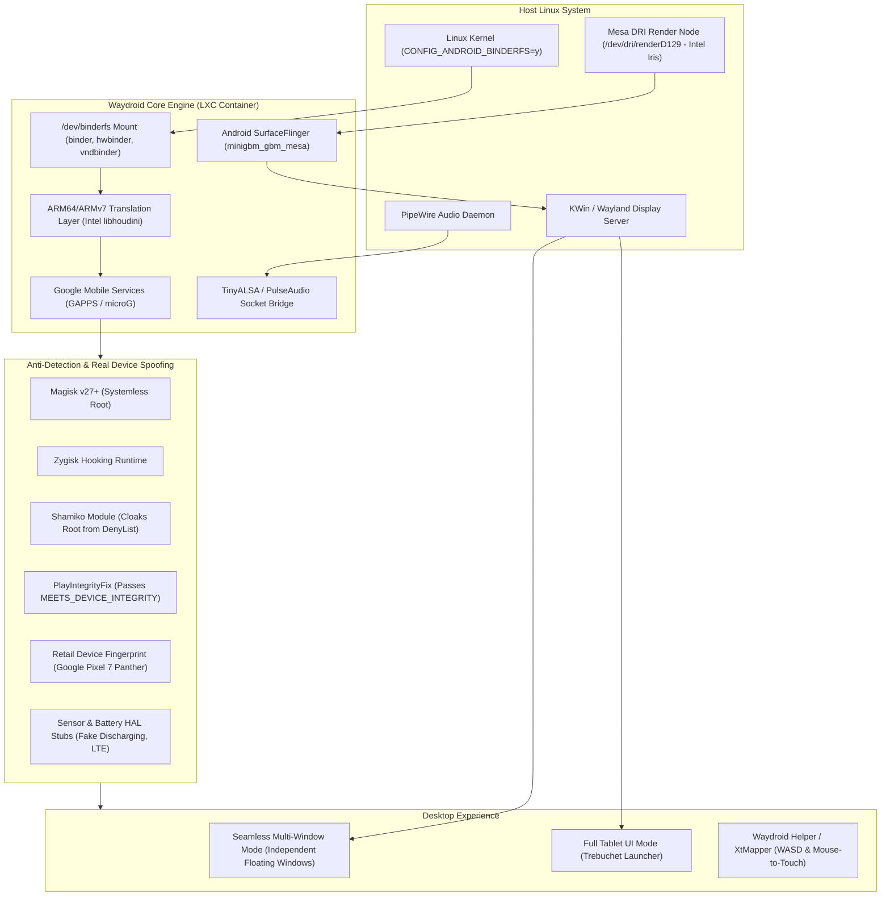
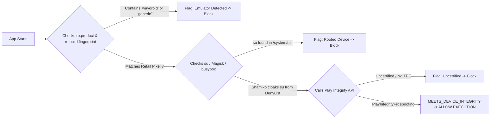

# Native Android Sandbox on Linux: Architecture & Research Report

This report presents an architectural blueprint and technical analysis for building a **native, lightweight Android sandbox** on Linux, providing a modern alternative to BlueStacks with near-zero virtualization overhead and anti-detection capabilities.

---

## 1. Executive Summary & Comparison: Native Container vs. BlueStacks

Traditional Android emulators like **BlueStacks**, **Nox**, and **LDPlayer** were built primarily for Windows using heavy, type-2 hypervisors (VirtualBox or modified QEMU forks). On Linux, because Android is itself built on the Linux kernel, we can run Android **natively** within kernel namespaces and cgroups using **LXC** or **Docker**, eliminating virtualization overhead completely.

| Dimension | BlueStacks 5 (Windows/macOS VM) | Native Android Sandbox (Waydroid / ReDroid on Linux) |
| :--- | :--- | :--- |
| **Execution Engine** | Full OS Hypervisor (QEMU / VirtualBox VM) | Native Host Kernel Namespaces (`LXC` / `Docker`) |
| **CPU Overhead** | High (Virtualization trap-and-emulate, nested paging) | **Zero** (Native CPU instructions, 0% idle CPU) |
| **RAM Footprint** | **4 GB – 8 GB** minimum allocation | **400 MB – 800 MB** idle RAM |
| **GPU Acceleration** | Emulated DirectX/OpenGL translation layer | **Direct DRI / Mesa hardware rendering** (Vulkan, EGL, Iris) |
| **Startup Time** | 30 – 60 seconds | **1 – 3 seconds** |
| **Display Integration** | Heavy emulator window containing fake screen | **Native Wayland multi-window** (apps float like Linux apps) |
| **Bloat / Privacy** | Ads, bundled adware, proprietary tracking | **100% open source**, zero ads, clean AOSP / LineageOS |
| **Multi-instance Cost** | Multiplies RAM usage by 4GB+ per instance | Multiplies RAM usage by ~350MB per instance |

---

## 2. Core Subsystems Architecture

---

## 3. Critical Technical Challenges & Solutions

### A. GPU Acceleration on Hybrid Laptops (Intel Alder Lake + NVIDIA RTX)
> [!WARNING] The Hybrid GPU Pitfall
> Waydroid requires EGL/GBM buffer sharing with the host Wayland compositor. Proprietary NVIDIA drivers do not support standard GBM contexts inside unprivileged containers. On hybrid systems:
> - `renderD128` is typically mapped to the discrete NVIDIA card.
> - `renderD129` is mapped to the integrated Intel/AMD GPU.
>
> If Waydroid defaults to `renderD128`, it fails or crashes into a black screen. **Solution:** We explicitly bind Waydroid to `/dev/dri/renderD129` (Mesa Iris driver), giving silky-smooth 60/120 FPS hardware acceleration with zero driver crashes.

---

### B. ARM64 / ARMv7 Binary Translation (`libhoudini` vs `libndk`)
90%+ of Play Store games and commercial apps contain native compiled ARM libraries (`arm64-v8a` or `armeabi-v7a`). When running on an x86_64 PC, Android will reject them with `INSTALL_FAILED_NO_MATCHING_ABIS`.
- **`libhoudini`** (Intel): Extracted from Intel Android and Windows Subsystem for Android (WSA). Provides superior translation efficiency, memory bandwidth, and JIT caching for 3D games and complex applications.
- **`libndk`** (Google): Extracted from ChromeOS. Highly stable for utility and enterprise applications.
- **Implementation:** Automated injection into the Waydroid rootfs, enabling both 64-bit and 32-bit ARM ABIs.

---

### C. Running Apps "As If They Are Running in a Real Android"
Modern Android applications (banking, payment apps like Google Pay / PhonePe, games with anti-cheat, streaming apps like Netflix, and social apps like Snapchat) employ aggressive environment checks:

#### The 5 Layers of the Chameleon Anti-Detection Stack:
1. **Device Fingerprint Spoofing (`build.prop`):** Replaces default LineageOS / Waydroid identifiers with a certified retail device footprint (e.g. Google Pixel 7 `panther` running Android 14).
2. **Google Services Framework (GSF) ID Certification:** Extracts the container's unique Android GSF ID and submits it to Google's device registration portal, turning "Device is uncertified" into certified Play Protect status.
3. **Root Cloaking via Shamiko:** Magisk v27 with Zygisk enabled. Rather than using Magisk's built-in DenyList (which can be detected by modern anti-tamper SDKs), **Shamiko** hooks at the Zygote stage to completely hide root binaries, mounts, and properties from target apps without triggering enforce-denylist flags.
4. **Play Integrity Bypass:** Injects `PlayIntegrityFix` to satisfy `MEETS_BASIC_INTEGRITY` and `MEETS_DEVICE_INTEGRITY`, allowing banking and protected applications to run.
5. **Sensor & Battery Stubs:** Injects realistic hardware states via `dumpsys battery` (85% battery, discharging status, 28°C battery health) and telephony properties (`gsm.sim.state=READY`, carrier `T-Mobile` / `Jio`), preventing apps from spotting missing battery/cellular controllers.

---

## 4. The Dual-Engine Strategy

To give you the best of both worlds, the plan implements a **Dual-Engine Architecture**:

1. **Engine 1: Waydroid (The Desktop Daily Driver)**
   - Used for interactive gaming, social media, messaging, and daily desktop apps.
   - Apps launch as native Wayland windows or inside a full tablet interface.
   - Direct PipeWire audio, clipboard sharing, and folder sharing.
2. **Engine 2: ReDroid (The Disposable Sandbox)**
   - Used for testing suspicious APKs, isolated multi-instance testing, or multi-account farming.
   - Runs in isolated Docker containers with independent ADB ports (`5555`, `5556`, etc.).
   - Instant visual streaming via ultra-low latency `scrcpy`.
   - Single command wipe (`./bin/asandbox disposable reset`) to discard malware or session state in seconds.
